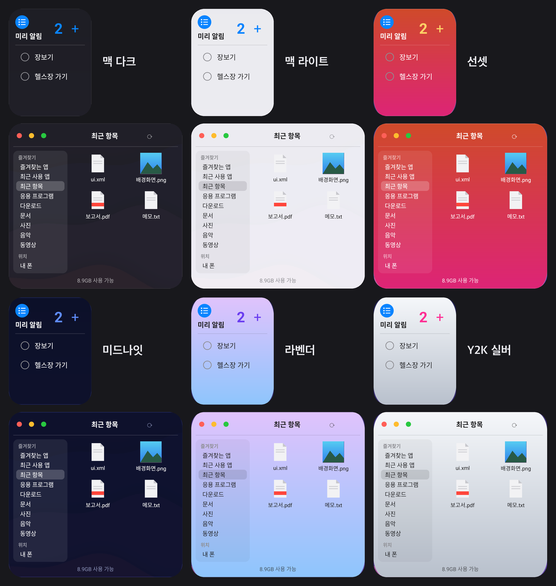

# Mac 위젯 (MacLauncher)

안드로이드(갤럭시 One UI 기준) 홈 화면에 놓는 **macOS 스타일 위젯 모음**입니다.
시스템 모니터, 달력, Finder, Dock, 저장 공간, 미리 알림, 배터리 등 17종을 맥 다크·라이트와 여러 **감성 팩**으로 꾸밀 수 있어요.

<p align="center"></p>

> Apple, macOS, Finder는 Apple Inc.의 상표입니다. 이 프로젝트는 Apple과 관련 없는 개인 프로젝트이며, Apple의 이미지나 코드를 쓰지 않았습니다.

## 설치

1. [Releases](../../releases)에서 최신 `MacWidgets-x.y.z.apk`를 받습니다.
2. 폰에서 APK를 열고, "출처를 알 수 없는 앱 설치"를 허용한 뒤 설치합니다.
3. **Mac 위젯** 앱을 열고 원하는 위젯의 **홈 화면에 추가**를 누릅니다.
   (또는 홈 화면 빈 곳 길게 누르기 → 위젯 → Mac 위젯)

안드로이드 10 이상에서 동작합니다. 갤럭시 Z 폴드(One UI)에서 주로 테스트했어요.

## 위젯

| 위젯 | 하는 일 |
|---|---|
| **시스템 모니터** | CPU 링 + 그래프, 메모리 사용량. 화면이 켜져 있는 동안 1초마다 갱신. 탭 → 디바이스 케어(최적화), 메모리 줄 탭 → 메모리 정리 |
| **달력** | 월간 달력, ◀ ▶로 달 이동, 오늘 표시. 작게 줄이면 요일/날짜만 |
| **Finder** | 즐겨찾는 앱(폴더 이름·색 지정), 최근 사용 앱, 최근 항목, 응용 프로그램, 다운로드·문서·사진 등. 폴더는 위젯 안에서 열리고 파일·앱은 탭하면 실행 |
| **응용 프로그램** | 설치된 앱을 분류별로 (전체/최근 설치/게임/소셜/사진·동영상/음악/생산성) |
| **Dock** | 고른 앱을 Mac Dock처럼 한 줄로. 아이콘은 macOS 모양으로 |
| **저장 공간** | 'Macintosh HD'처럼 앱·사진·동영상·음악·문서별 사용량 막대. 탭 → 저장공간 화면 |
| **미리 알림** | 위젯에서 바로 추가 / 체크 / 수정 |
| **배터리** | 폰 + 연결된 블루투스 기기(버즈 등) 배터리 링 |
| **시계** | macOS 아날로그 시계, 넓게 놓으면 세계 시계 |
| **날씨** | 현재 위치 날씨와 4일 예보 (Open-Meteo) |
| **메모** | macOS 스티커처럼 색깔 메모지 |
| **사진** | 갤러리 사진을 1시간마다 바꿔 보여줌 |
| **지금 재생 중** | 재생 중인 음악의 앨범 아트·제목, ⏮ ⏯ ⏭ |
| **스크린 타임** | 오늘 사용 시간, 시간대별 막대, 많이 쓴 앱 |
| **단축어** | 손전등·와이파이·타이머 등을 색 타일로 바로 실행 |
| **타이머** | 주황 링 타이머, 위젯에서 바로 시작·일시정지 |
| **네트워크** | 실시간 다운로드·업로드 속도와 오늘 데이터 사용량 |

모두 홈 화면에서 길게 눌러 크기를 바꿀 수 있고, 작게 줄이면 그 크기에 맞는 모양으로 바뀝니다.
앱 맨 위 **위젯 감성**에서 팩을 고르면 놓여 있는 위젯이 모두 바로 바뀌어요.

| 감성 팩 | |
|---|---|
| 맥 다크 · 맥 라이트 · 선셋 · 미드나잇 · 모노 | 무료 |
| 오션 글래스 · 버블껌 · 포레스트 · 라벤더 · Y2K 실버 · 말차 | 프리미엄 (Play 스토어 버전에서 인앱 구매) |

팩마다 위젯 배경, 글자색, 그래프·링 색, 강조색(달력 오늘, CPU 그래프 등)이 함께 바뀝니다.
**자동**을 고르면 폰 다크 모드에 맞춰 맥 다크/맥 라이트로 알아서 바뀌어요.
**백업**에서 즐겨찾기·Dock·메모·미리 알림·테마를 파일로 내보내고 불러올 수 있어요.

## 권한 (필요한 위젯만)

| 권한 | 쓰는 곳 | 없으면 |
|---|---|---|
| 알림 | 시스템 모니터 1초 갱신 중 표시 | 갱신은 되지만 알림이 안 보임 |
| 모든 파일 접근 | Finder 파일 보기, 저장 공간 항목별 용량 | 위젯에 '탭해서 허용' 안내 |
| 사용 정보 접근 | Finder '최근 사용 앱', 스크린 타임, 네트워크 오늘 사용량 | 위젯에 '탭해서 허용' 안내 |
| 근처 기기 | 배터리 위젯의 블루투스 기기 | 폰 배터리만 표시 |
| 위치 (대략) | 날씨 | 위젯에 '탭해서 허용' 안내 |
| 캘린더 | 달력 일정 표시 | 날짜만 표시 |
| 사진 | 사진 위젯 | 위젯에 '탭해서 허용' 안내 |
| 알림 접근 | 지금 재생 중 (재생 정보만 읽음) | 위젯에 '탭해서 허용' 안내 |

모든 데이터(미리 알림, 즐겨찾기 등)는 폰 안에만 저장되고 인터넷으로 보내지 않습니다.
날씨 위젯만 대략적인 위치(약 1km 단위)를 Open-Meteo로 보내 예보를 받아요. 자세한 내용은 [개인정보처리방침](PRIVACY.md).

## 알아둘 점

- 시스템 모니터는 실시간 갱신을 위해 알림창에 '시스템 모니터' 알림이 떠 있고, 화면이 꺼지면 멈춥니다.
- 삼성 배터리 최적화가 갱신을 멈추면 위젯에 '탭하면 실시간 갱신 시작'이 뜹니다. 자주 멈추면 설정 → 애플리케이션 → Mac 위젯 → 배터리 → 제한 없음.
- 블루투스 기기 배터리는 안드로이드 숨은 API로 읽어서 기기에 따라 안 보일 수 있어요.
- 홈 화면 아이콘을 위젯으로 끌어다 놓는 건 안드로이드 위젯 구조상 안 됩니다. 즐겨찾기는 ＋ 편집으로 골라요.

## 직접 빌드

```
echo "sdk.dir=$HOME/Library/Android/sdk" > local.properties
./gradlew assembleDebug
adb install -r app/build/outputs/apk/debug/app-debug.apk
```

배포용(`assembleRelease`) 서명 키와 비밀번호는 `~/.gradle/gradle.properties`의 `MACLAUNCHER_*` 값에서 읽습니다 (저장소에 없음).

라이트 테마 레이아웃·드로어블·스타일(`*_light`)은 다크 쪽에서 자동 생성합니다. 다크 레이아웃을 고친 뒤 다시 돌리세요:
```
python3 tools/gen_light_widgets.py
```

## 구조

- `widget/MonitorWidget` · `MonitorService` · `MonitorGraphics` : 시스템 모니터, 1초 갱신 서비스, 링/그래프 비트맵
- `widget/CalendarWidget` : 달력 (RemoteViews 42칸)
- `widget/finder/` : Finder (`FinderWidget` 상태/사이드바, `FinderItemsService` 격자, `FinderOpenActivity` 탭 처리, `FinderFiles` 위치·목록, `FavoritesStore`/`FavoritesActivity` 즐겨찾기와 폴더, `RecentApps` 최근 사용 앱)
- `widget/apps/` : 응용 프로그램 (`AppCatalog` 분류, `AppsWidget`/`AppsItemsService` 격자, `AppLaunchActivity` 실행)
- `widget/dock/` : Dock (`DockWidget`, `DockConfigActivity` 앱 고르기)
- `widget/StorageWidget` : 저장 공간 (StorageStatsManager + MediaStore)
- `widget/reminders/` : 미리 알림 (`ReminderStore`, `RemindersWidget`/`RemindersService`, `ReminderActivity`)
- `widget/BatteryWidget` : 배터리 (블루투스는 HiddenApiBypass로 getBatteryLevel)
- `widget/MacIcon` : 앱 아이콘을 APK 원본에서 읽어 macOS 스쿼클로
- `widget/WidgetTheme` · `WidgetSize` · `WidgetRefresher` · `SystemShortcuts` : 테마, 크기별 레이아웃, 전체 다시 그리기, 삼성 디바이스 케어 바로가기
- `ui/AppPicker` : Dock과 즐겨찾기가 같이 쓰는 앱 고르기
- `widget/skin/` : 감성 팩 (`SkinPack` 데이터, `Skin` 팩 목록·배경·글자색 입히기, `SkinGraphics` 배경 비트맵, `SkinPrefs` 선택, `Entitlements`/`SkinBilling` 프리미엄 해금·Play 결제)
- `MainActivity` : 위젯 추가·감성 선택 화면

### 새 감성 팩 만들기

`Skin.kt`에 `SkinPack` 하나를 추가하고 `BUILTIN`에 넣으면 끝입니다 (레이아웃 수정 불필요).
위젯 레이아웃의 글자색은 역할(본문 `#FFFFFF`/`#1C1C1E`, 보조 `#99FFFFFF`/`#8E8E93`, 흐림 `#66FFFFFF`/`#AEAEB2`)로 읽혀 팩 팔레트로 바뀌고,
그 밖의 색(일요일 빨강 등)은 그대로 둡니다. 새 라벨을 넣을 때 역할 색을 쓰고 `android:id`를 달아 주세요.
